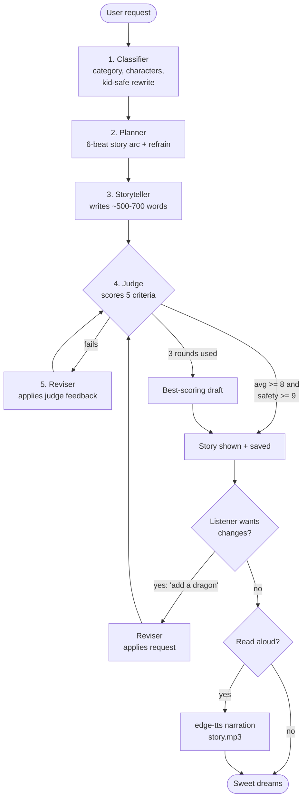

# Bedtime Story Generator

A command-line storyteller for children aged 5-10. Give it any story request and it plans, writes, grades and revises a bedtime story, lets the listener ask for changes, and can read the finished story aloud.

It uses the `gpt-5.6-terra` model for every step.

## How it works



### The pipeline

1. **Classifier.** Sorts the request into one of five categories (adventure, animal friends, fantasy and magic, everyday life, silly and funny), pulls out the main characters, and rewrites the request into a kid-safe version. Every later step works from that rewrite, never from the raw input, so anything scary or inappropriate is removed before a story is planned.
2. **Planner.** Builds a six-beat outline: setting and characters, the problem or wish, a first try that doesn't quite work, the turning point, the resolution, and a cozy wind-down. It also suggests a short refrain the child can repeat. Each category has its own style guide that shapes the plan, for example gentle magic with simple rules for fantasy, or running jokes and wordplay for silly stories.
3. **Storyteller.** Writes about 500-700 words from the outline, following shared rules for audience, vocabulary, tone and length. The ending always slows down into calm, sleepy imagery.
4. **Judge.** Scores the story from 1 to 10 on age appropriateness, story arc, engagement, bedtime tone and request fit, and returns specific fixes. A story passes only if the average is at least 8 **and** age appropriateness is at least 9, so safety is a hard gate rather than something a high average can hide.
5. **Reviser.** Rewrites the story using the judge's notes while keeping what already works. The judge and reviser loop for up to three rounds and the best-scoring draft is kept, in case a revision makes things worse.

### Listener feedback and narration

After the story is shown, the listener can ask for changes ("make it funnier", "add a dragon"). Each request goes through the reviser and then back through the judge, so edits stay age-appropriate and on-request. Pressing Enter, or typing `n` or `no`, keeps the story as is and moves on.

If the listener chooses to hear the story, it is narrated with [edge-tts](https://github.com/rany2/edge-tts) using a soft neural voice at a slightly slower pace, saved as `story.mp3`, and opened in the default audio player.

## Design notes

- **Defensive parsing.** The classifier and judge ask for JSON, and model output doesn't always follow the format. Replies are parsed by extracting the first `{...}` block, scores are clamped to 1-10, and every step has a fallback so one bad response doesn't crash the run.
- **Safety in two places.** The classifier sanitizes the request up front, and the judge enforces a minimum age-appropriateness score on every draft, including user-requested edits.
- **Best-draft tracking.** Revisions can make a story worse, so the loop returns the highest-scoring version it saw rather than just the last one.
- **One wrapper for every call.** All prompts go through a single `call_model` function, which keeps model settings in one place.

## Setup

Requires Python 3.9+ and an OpenAI API key.

```bash
git clone https://github.com/pmehta5/Bedtime-Story-Agent.git
cd Bedtime-Story-Agent
pip install -r requirements.txt
export OPENAI_API_KEY="your-key"   # never commit this
python bedtime-storyteller.py
```

On Windows PowerShell, set the key with `$env:OPENAI_API_KEY="your-key"`. Alternatively, copy `.env.example` to `.env` and put the key there; the script loads it automatically, and `.env` is git-ignored.

Press Enter at the first prompt to use a built-in example request. Narration needs an internet connection.

## Configuration

These settings are at the top of `bedtime-storyteller.py`:

| Setting | Default | Meaning |
|---|---|---|
| `MAX_JUDGE_ROUNDS` | 3 | Maximum judge and revise cycles before the best draft is used |
| `PASS_SCORE` | 8.0 | Average judge score needed to accept a story |
| `MIN_SAFETY_SCORE` | 9 | Minimum age-appropriateness score, regardless of the average |
| `VERBOSE` | True | Print classifier, planner and judge scores as the loop runs |

Narration voice and speed are set by `TTS_VOICE` and `TTS_RATE`.

## Project layout

```
bedtime-storyteller.py   # the whole pipeline and CLI
requirements.txt         # openai==0.28.1, python-dotenv, edge-tts
.env.example             # template for local API key
```

The script writes `story.txt` and `story.mp3` to the working directory after each story. Both are temporary and git-ignored. It uses the legacy `openai==0.28` SDK.

## Future improvements

- Generate a full storybook PDF with illustrations.
- Ask the listener whether they liked the story, and if so let them save it so it can be continued in a later session.
- Ask for the child's age up front so the vocabulary and sentence complexity can be tuned, since 5 to 10 covers very different reading levels.
